<p align="center">
  <picture>
    <source media="(prefers-color-scheme: dark)" srcset=".github/images/logo_dark.png" />
    <source media="(prefers-color-scheme: light)" srcset=".github/images/logo_light.png" />
    
  </picture>
</p>

<!-- mcp-name: io.github.MervinPraison/praisonai -->

<p align="center">
<a href="https://github.com/MervinPraison/PraisonAI"></a>
<a href="https://github.com/MervinPraison/PraisonAI"></a>
<a href="https://github.com/MervinPraison/PraisonAI"></a>
</p>

# PraisonAI

**AI agents that run on your own computers, even fully offline.**

[2M+ downloads](https://pepy.tech/projects/praisonai) · [9.3K stars](https://github.com/MervinPraison/PraisonAI) · [600+ releases in the last year](https://github.com/MervinPraison/PraisonAI/releases) · [80+ contributors](https://github.com/MervinPraison/PraisonAI/graphs/contributors) · MIT

<table>
<tr>
<td colspan="3">
<b>Private AI</b> <i>(early access)</i><br />
Private AI that earns trust one task at a time. Each task moves to your own AI only after it passes a test. If quality slips, it moves back automatically, and every step is recorded for regulators. For banks, insurers and hospitals.<br />
<a href="https://praison.ai/enterprise/"></a>
<a href="#how-the-handover-works-early-access">How the handover works</a> · <a href="#whats-new">What's new</a>
</td>
</tr>
<tr>
<td width="33%" valign="top">
<a href="src/praisonai-agents"><b>Agents</b></a><br />
<sub>Python agent framework: teams, workflows, memory, tools.</sub><br />
<code>pip install praisonaiagents</code><br />
<a href="#quick-start">Your first agent</a>
</td>
<td width="33%" valign="top">
<a href="src/praisonai-bot"><b>Bot</b></a><br />
<sub>Your agent on Telegram, Discord, Slack and WhatsApp, 24/7.</sub><br />
<code>pip install "praisonai-bot[gateway,bot]"</code><br />
<code>praisonai-bot onboard</code>
</td>
<td width="33%" valign="top">
<a href="src/praisonai-code"><b>Code</b></a><br />
<sub>An agent in your terminal that reads and edits your code.</sub><br />
<code>pip install praisonai-code</code><br />
<code>praisonai-code code</code>
</td>
</tr>
<tr>
<td valign="top">
<a href="src/praisonai-mcp"><b>MCP</b></a><br />
<sub>Your agents and tools inside Cursor, Claude Desktop and other MCP clients.</sub><br />
<code>pip install praisonai-mcp</code><br />
<code>praisonai-mcp connect cursor</code>
</td>
<td valign="top">
<a href="src/praisonai-train"><b>Train</b></a><br />
<sub>Fine-tune an open model on your own GPUs, and train agents on past runs.</sub><br />
<code>pip install "praisonai-train[llm]"</code><br />
<code>praisonai-train --help</code>
</td>
<td valign="top">
<b>All of it</b><br />
<sub>CLI, bots, dashboard and integrations in one install.</sub><br />
<code>pip install "praisonai[dashboard]"</code><br />
<code>praisonai setup</code>
</td>
</tr>
</table>

<p align="center">
  
  <br />
  <sub>A real run with <code>pip install praisonai</code>: a local Llama 3.2 model through Ollama, with no API key set.</sub>
</p>

## How it fits together

<p align="center">
  <picture>
    <source media="(prefers-color-scheme: dark)" srcset=".github/images/readme/architecture-dark.svg" />
    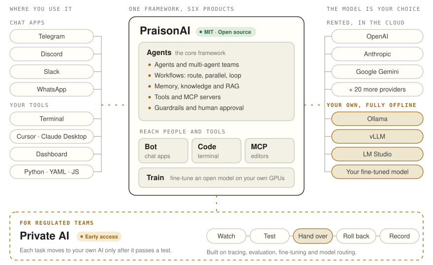
  </picture>
</p>

## Quick start

Set a key for any supported provider (OpenAI shown here), or skip the key and use a local model as in the next section.

```bash
pip install praisonai
export OPENAI_API_KEY="your-api-key"
```

```python
from praisonai import Agent

agent = Agent(instructions="You are a helpful assistant.")
print(agent.start("In two sentences, why do some companies keep their data on their own computers?"))
```

Only want the lightweight core? `pip install praisonaiagents` and write `from praisonaiagents import Agent`; the rest of the code is the same.

## Run fully offline

Run the same agent on a model on your own computer with [Ollama](https://ollama.com). You need no API key, and your prompts and answers stay on the machine.

Install the package and pull the model while you still have internet; after that, the agent runs with no network at all. `pip install praisonai` includes local-model support; with only the core library, use `pip install "praisonaiagents[llm]"`.

```bash
# Start Ollama first (the app, or "ollama serve" in another terminal)
ollama pull llama3.2
export DO_NOT_TRACK=true   # keeps telemetry off (PraisonAI sends none unless you turn it on)
```

```python
from praisonai import Agent

agent = Agent(instructions="You are a helpful assistant.", model="ollama/llama3.2")
print(agent.start("Why is the sky blue?"))
```

If Ollama runs on another computer on your network, pass `base_url` (or set `OLLAMA_API_BASE`):

```python
agent = Agent(instructions="...", model="ollama/llama3.2", base_url="http://192.168.1.10:11434")
```

vLLM and LM Studio work the same way: use `hosted_vllm/` (vLLM) or `lm_studio/` with your server's `base_url`. More in the [Ollama guide](https://praison.ai/docs/models/ollama) and [Models docs](https://praison.ai/docs/models).

## What you can build

<table>
<tr>
<td width="33%" valign="top">
<a href="https://praison.ai/docs/cli/bot"><picture><source media="(prefers-color-scheme: dark)" srcset=".github/images/ui/bot-desktop-dark.webp" />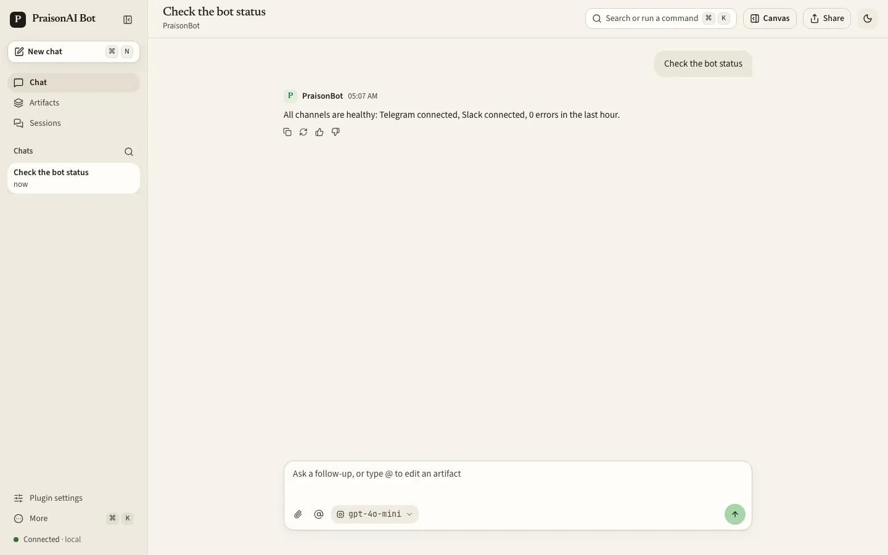</picture></a><br />
<b>Bots</b><br /><sub>Telegram, Discord, Slack and WhatsApp, with memory. <a href="https://praison.ai/docs/features/bot-gateway">Gateway</a></sub>
</td>
<td width="33%" valign="top">
<a href="https://praison.ai/docs/concepts/claw"><picture><source media="(prefers-color-scheme: dark)" srcset=".github/images/ui/claw-desktop-dark.webp" />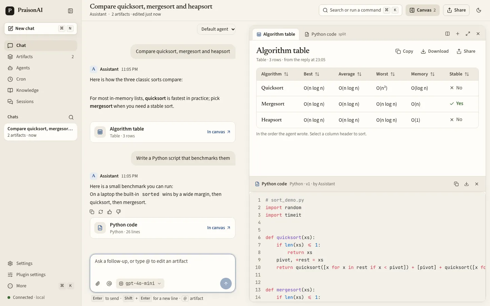</picture></a><br />
<b>Dashboard</b><br /><sub>Chat, agents, memory, knowledge and channels in one app.</sub>
</td>
<td width="33%" valign="top">
<a href="https://praison.ai/docs/cli/mcp"></a><br />
<b>Your agents in Cursor</b><br /><sub><code>praisonai-mcp connect cursor</code>: 85 tools, one command. A real run.</sub>
</td>
</tr>
<tr>
<td valign="top"><b><a href="https://praison.ai/docs/concepts/agentflow">Multi-agent teams</a></b><br /><sub>Handoffs, route, parallel, loop and repeat.</sub></td>
<td valign="top"><b><a href="https://praison.ai/docs/concepts/memory">Memory and RAG</a></b><br /><sub>Memory, knowledge and sessions, with zero extra deps to start.</sub></td>
<td valign="top"><b><a href="https://praison.ai/docs/tools/tools">Tools and MCP</a></b><br /><sub>Your own <code>@tool</code> or any MCP server.</sub></td>
</tr>
<tr>
<td valign="top"><b><a href="https://praison.ai/docs/cli/code">Coding agent</a></b><br /><sub><code>praisonai code</code>, <code>run</code> and <code>chat</code> in your terminal.</sub></td>
<td valign="top"><b><a href="https://praison.ai/docs/features/browser-agent">Browser automation</a></b><br /><sub>An agent that uses websites for you.</sub></td>
<td valign="top"><b><a href="https://praison.ai/docs/features/sandbox">Sandboxes</a></b><br /><sub>Run tools in Docker, E2B, Modal and more.</sub></td>
</tr>
<tr>
<td valign="top"><b><a href="https://praison.ai/docs/train">Fine-tuning</a></b><br /><sub>Train an open model on your own past work.</sub></td>
<td valign="top"><b><a href="#using-yaml-no-code">YAML, no code</a></b><br /><sub>Agents and workflows from one file.</sub></td>
<td valign="top"><b><a href="https://praison.ai/docs/deploy">Deploy</a></b><br /><sub>Ship agents as APIs or to the cloud.</sub></td>
</tr>
</table>

> **Open Products** — Built directly on PraisonAI with zero duplicated code:
> **[PraisonAI Ship](products/openship/)** *(OpenShip)* — open-source PR shipping, self-review, PR Steward, and declarative `.praisonai/approvals.yml` on any LLM or local Ollama (draft PRs only; never merges). Browse all [`products/`](products/).

## The Five-Layer Agent Stack

Most frameworks hand you one or two layers and leave the rest as homework. PraisonAI covers **all five** — plus the outer layer that decides *where* your agent actually runs.

Each layer wraps the one inside it. When an agent misbehaves, the layer tells you where to look.

<p align="center">
  <picture>
    <source media="(prefers-color-scheme: dark)" srcset=".github/images/readme/stack-dark.svg" />
    
  </picture>
</p>

| Layer | The question it answers | PraisonAI |
|:--|:--|:--|
| **1 · Prompt** | Did I say it clearly? | `instructions=`, `role`/`goal`/`backstory`, `output=`, `templates=` |
| **2 · Context** | Is the right thing in the window? | `memory=`, `knowledge=`, `context=`, handoff `ContextPolicy` |
| **3 · Harness** | Can it act, and be checked? | `tools=`, `MCP()`, `guardrails=`, `approval=`, `hooks=`, `sandbox=` |
| **4 · Loop** | When do we stop? | `execution=ExecutionConfig(...)`, `reflection=`, `autonomy=`, doom-loop detection |
| **5 · Graph** | Who runs when, and who checks whom? | `AgentFlow`, `route()`, `parallel()`, `loop()`, `repeat()` |
| **⬡ Managed** | *Where does it actually run?* | `tools_run_on="docker"` — one shared sandbox for the tools, or `run_on="anthropic"` for the whole agent |

<details>
<summary><strong>Show an example for each layer, and Managed Agents</strong></summary>

### Layer 1 · Prompt — *Did I say it clearly?*

Role, instructions, examples, output format.

```python
from praisonai import Agent

agent = Agent(
    role="Senior Data Analyst",
    goal="Turn raw numbers into decisions",
    output="verbose",              # markdown-formatted output
)
agent.start("Summarise Q3 revenue trends")
```

### Layer 2 · Context — *Is the right thing in the window?*

Write, select, compress, isolate — the four context operations, one parameter each.

```python
from praisonai import Agent

agent = Agent(
    instructions="You are a support engineer.",
    memory={"user_id": "u-42"},    # write    — persists across runs (needs a user_id)
    knowledge=["docs/"],           # select   — retrieves only what's relevant
    context="summarize",           # compress — auto-compacts before the limit
)
```

> **Isolate** is `handoffs=[specialist]` — a sub-agent inherits the last few messages and the intersection of your tools, not your whole transcript. [📖 Handoffs](https://praison.ai/docs/concepts/handoffs)

### Layer 3 · Harness — *Can it act, and be checked?*

*Agent = Model + Harness.* Tool dispatch, plus the guides that steer before acting and the sensors that observe after.

```python
from praisonai import Agent, MCP, tool

@tool
def deploy(env: str) -> str:
    """Deploy the current build to an environment."""
    return f"Deployed to {env}"

agent = Agent(
    name="ReleaseEngineer",
    instructions="You are a release engineer.",
    tools=[deploy, MCP("npx -y @modelcontextprotocol/server-filesystem /tmp")],
    approval=True,                 # guide — human gate before risky tools run
)
agent.start("Deploy to staging, then list the files you can read")
```

### Layer 4 · Loop — *When do we stop?*

Hard iteration caps, budget ceilings, no-progress detection and completion checks — every brake is explicit.

```python
from praisonai import Agent, ExecutionConfig

agent = Agent(
    instructions="Fix the failing tests.",
    execution=ExecutionConfig(max_iter=30, max_budget=0.50, on_budget_exceeded="stop"),
    autonomy=True,                 # required to drive the loop with run_autonomous()
)
result = agent.run_autonomous("Refactor the auth module", max_iterations=5)

print(result.completion_reason)
# goal | no_tool_calls | max_iterations | timeout | doom_loop | needs_help | error
# (with on_budget_exceeded="stop", hitting the cap raises BudgetExceededError,
#  surfaced here as completion_reason="error")
```

> **Doom-loop detection is on by default.** Repeated identical tool calls and A→B→A→B oscillation get caught — while a poller whose output keeps changing does not. [📖 Doom Loop Detection](https://praison.ai/docs/features/doom-loop-detection)

### Layer 5 · Graph — *Who runs when, and who checks whom?*

Topology as a versionable artifact: prompt chaining, routing, parallelisation, orchestrator-worker.

```python
from praisonai import AgentFlow
from praisonai import route, parallel, repeat

flow = AgentFlow(steps=[
    classifier,
    route({"bug": [bug_agent], "feature": [feature_agent], "default": [triage]}),
    parallel([reviewer, tester]),                      # fan out, join automatically
    repeat(editor, until=lambda ctx: "approved" in ctx.previous_result.lower(),
           max_iterations=3),                          # evaluator–optimizer
])
flow.run("Ticket #123: login fails on Safari")
```

> The same graph is expressible in YAML with no Python at all. [📖 AgentFlow](https://praison.ai/docs/concepts/agentflow)

### ⬡ Outside the stack: Managed Agents — *Where does it actually run?*

The harness is commoditising; **where** the agent executes is the next multiplier. Rather than burning your laptop's CPU, hand an agent a short-lived cloud sandbox — repo, tools and tests run there.

```bash
pip install praisonai
```

The simplest way in is `tools_run_on=` — one whole team or workflow shares **one** sandbox, so a file written by step 1 is there for step 2. Thinking stays on your machine:

```python
from praisonai import Agent, AgentFlow

writer = Agent(name="Writer", instructions="You write files.")
reader = Agent(name="Reader", instructions="You read files.")

flow = AgentFlow(tools_run_on="docker", steps=[writer, reader])  # or e2b | modal | daytona | flyio
flow.run("Write 'hello' to /workspace/note.txt, then read it back")
```

Same thing with no Python at all:

```yaml
name: remote-demo
tools_run_on: docker      # every step shares one sandbox
agents:
  writer: {role: Writer, goal: Write files}
  reader: {role: Reader, goal: Read files}
steps:
  - agent: writer
    action: "Write 'hello' to /workspace/note.txt"
  - agent: reader
    action: "Read /workspace/note.txt"
```

For a single agent, two words cover it — and they answer different questions:

```python
from praisonai import Agent

# A. Only the TOOLS move. Thinking stays on your machine.
agent = Agent(name="builder", instructions="You build things.",
              tools_run_on="docker")   # docker | e2b | modal | daytona | flyio
                                       # tenki | sandlock | ssh | novita | subprocess

# B. The WHOLE agent moves — model calls, loop and tools
agent = Agent(name="teacher", instructions="You teach.", run_on="anthropic")  # hosted
agent = Agent(name="builder", instructions="You build.", run_on="docker")     # self-hosted
agent.start("Write a Python script that prints the first 10 primes, then run it")
```

Ask any object where it runs, and it will tell you:

```python
>>> Agent(name="builder", instructions="x", tools_run_on="docker")
Agent(name='builder', thinks_on='this machine', tools_run_on='a Docker container')

>>> agent.where_does_it_run()
Thinking (the AI model calls) happens on this machine.
Tools run on a Docker container.
Your own tools (check_db) still run on this machine -- only shell, file and
code tools move. They read and write this machine's files.
```

Naming a place that cannot do the job is a typo, not a preference, so it says so:

```python
>>> Agent(name="x", instructions="i", run_on="e2b")
TypeError: Agent(run_on='e2b') is not valid: run_on= places the whole agent
-- model calls, loop and tools -- on a managed runtime, and 'e2b' runs
commands but cannot host an agent loop.
  To run only the tools there:  Agent(tools_run_on='e2b')
```

To run one block of code somewhere else, name the place on that call:

```python
agent.execute_code_sync("print(6 * 7)", run_in="sandlock")   # kernel-enforced
```

See what is running and reclaim strays:

```bash
praisonai managed ps          # list running sandboxes
praisonai managed stop --all  # reclaim them
```

Sandboxes shut themselves down when idle (`auto_shutdown`, `idle_timeout_s`), and a post-setup snapshot is reused so the next run skips the image pull and dependency install. Commit a `.praisonai/environment.yaml` and the environment travels with the repo.

> 📖 [20 runnable examples](examples/python/managed-agents/) · manage sessions with `praisonai managed sessions list <agent-id>` or `praisonai managed sessions resume <session-id> "<prompt>"`

<sub>Stack framing adapted from [The Five-Layer Agent Stack](https://mer.vin/2026/07/five-layer-agent-stack-match-bug-to-right-layer/) and [Agent Harnesses vs Orbs](https://mer.vin/2026/08/agent-harnesses-vs-orbs-why-remote-sandboxes-beat-local-agent-loops/).</sub>

</details>

## How the main features work

**Multi-agent patterns.** One `AgentFlow`, seven ways to run its steps. [Docs](https://praison.ai/docs/concepts/agentflow)

<p align="center">
  <picture>
    <source media="(prefers-color-scheme: dark)" srcset=".github/images/readme/multi-agent-patterns-dark.svg" />
    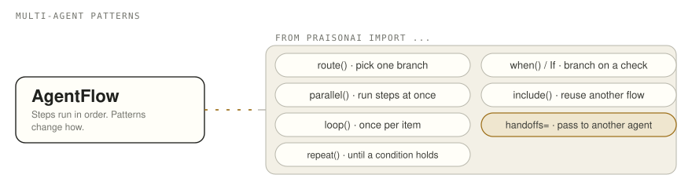
  </picture>
</p>

**Agent teams.** One `AgentTeam`, three ways to run the same tasks: in order, under a manager agent, or as a workflow. [Docs](https://praison.ai/docs/concepts/process)

<p align="center">
  <picture>
    <source media="(prefers-color-scheme: dark)" srcset=".github/images/readme/agent-team-dark.svg" />
    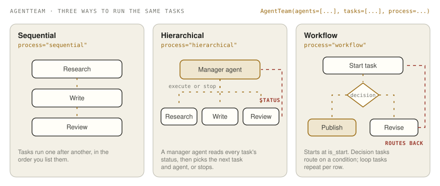
  </picture>
</p>

**One agent turn.** What happens between your prompt and the answer, and what stops it. [Docs](https://praison.ai/docs/features/doom-loop-detection)

<p align="center">
  <picture>
    <source media="(prefers-color-scheme: dark)" srcset=".github/images/readme/agent-turn-dark.svg" />
    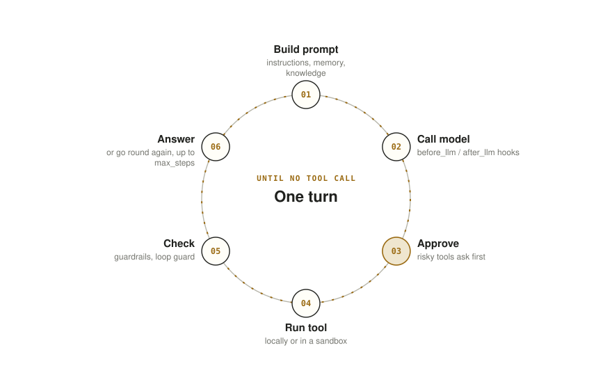
  </picture>
</p>

**Bot gateway.** Ten channels in, one agent, team or flow behind them. [Docs](https://praison.ai/docs/features/bot-gateway)

<p align="center">
  <picture>
    <source media="(prefers-color-scheme: dark)" srcset=".github/images/readme/bot-gateway-dark.svg" />
    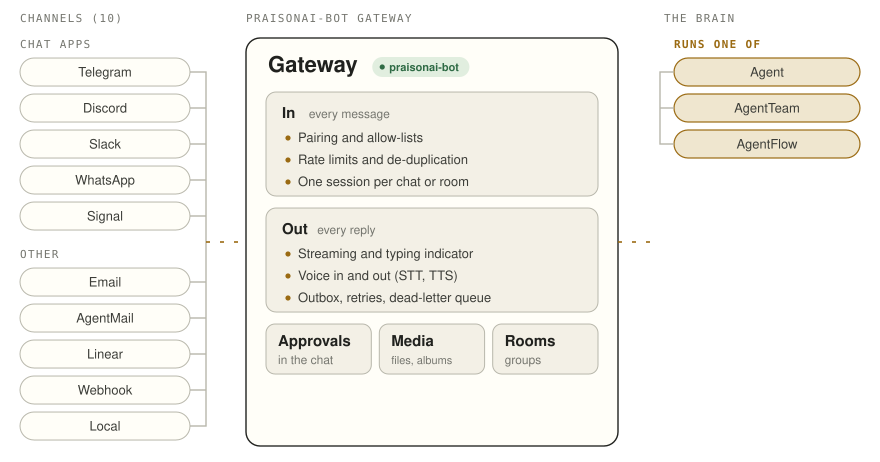
  </picture>
</p>

**MCP both ways.** Your agents use MCP servers, and your editor uses your agents. [Docs](https://praison.ai/docs/mcp/transports)

<p align="center">
  <picture>
    <source media="(prefers-color-scheme: dark)" srcset=".github/images/readme/mcp-both-ways-dark.svg" />
    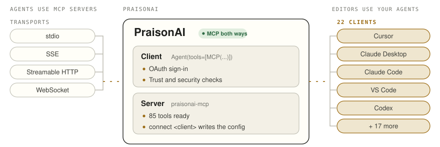
  </picture>
</p>

## How the handover works (early access)

<p align="center">
  <picture>
    <source media="(prefers-color-scheme: dark)" srcset=".github/images/readme/handover-dark.svg" />
    
  </picture>
</p>

1. **Watch:** records how each task is done today.
2. **Test:** your own AI takes an exam made from real past work it never studied.
3. **Hand over:** a task moves to your own AI only when it passes.
4. **Roll back:** if quality drops, the task moves back automatically.
5. **Record:** every handover leaves a record your regulator can check.

<p align="center">
  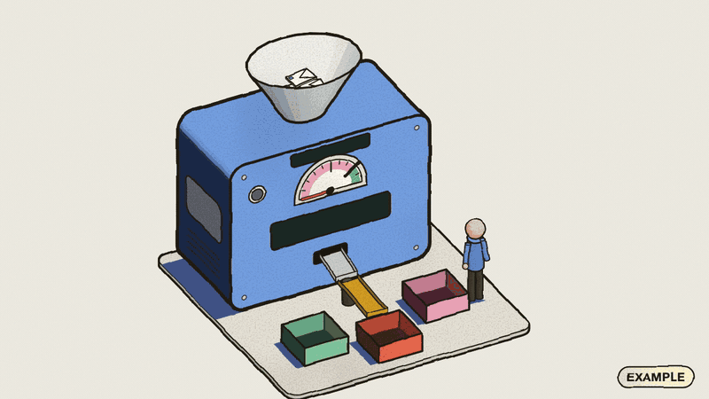
  <br />
  <sub>An illustration with example tasks, not customer data.</sub>
</p>

**What is "your own AI"?** An open model, such as Llama, Qwen or Gemma, running on your own computers. Use it as it is, or train it on your own past work with [PraisonAI Train](https://praison.ai/docs/train) on your own GPU servers. Your team decides when to train; nothing trains automatically. Either way, a task moves to it only after it passes that exam.

**Why now.** Highly regulated teams, such as banks, insurers and hospitals, want AI but can't send customer data to outside models. The largest banks built private AI in-house; most mid-size banks and insurers can't fund a team to do that. From 6 January 2027, OpenAI also takes no new self-serve fine-tuning jobs ([notice](https://developers.openai.com/api/docs/deprecations)), so teams that customise models need models they own.

The handover is built on parts of this framework that are live today: tracing, evaluation, fine-tuning, model routing and local models. It is in early access, and we are taking on our first design partners. The framework stays free and MIT-licensed. Design partners, investors and press: enterprise@praison.ai or [praison.ai/enterprise](https://praison.ai/enterprise/).

## JavaScript and TypeScript

```bash
npm install praisonai
```

The TypeScript and JavaScript SDK has its own guide at [praison.ai/docs/js](https://praison.ai/docs/js).

```javascript
const { Agent } = require('praisonai');
const agent = new Agent({ instructions: 'You are a helpful AI assistant' });
agent.start('Write a movie script about a robot in Mars');
```

## Install

### Desktop app

<div align="center">
  <a href="https://github.com/MervinPraison/PraisonAI/releases/latest">
    
  </a>
  &nbsp;&nbsp;
  <a href="https://github.com/MervinPraison/PraisonAI/releases/latest">
    
  </a>
  &nbsp;&nbsp;
  <a href="https://github.com/MervinPraison/PraisonAI/releases/latest">
    
  </a>
</div>

### Other ways to install

One-line installer:

```bash
curl -fsSL https://praison.ai/install.sh | bash
```

The full `praisonai` package, with the CLI and integrations. Add the `[dashboard]` extra for bots and the dashboard (`pip install "praisonai[dashboard]"`):

```
 ██████╗ ██████╗  █████╗ ██╗███████╗ ██████╗ ███╗   ██╗     █████╗ ██╗
 ██╔══██╗██╔══██╗██╔══██╗██║██╔════╝██╔═══██╗████╗  ██║    ██╔══██╗██║
 ██████╔╝██████╔╝███████║██║███████╗██║   ██║██╔██╗ ██║    ███████║██║
 ██╔═══╝ ██╔══██╗██╔══██║██║╚════██║██║   ██║██║╚██╗██║    ██╔══██║██║
 ██║     ██║  ██║██║  ██║██║███████║╚██████╔╝██║ ╚████║    ██║  ██║██║
 ╚═╝     ╚═╝  ╚═╝╚═╝  ╚═╝╚═╝╚══════╝ ╚═════╝ ╚═╝  ╚═══╝    ╚═╝  ╚═╝╚═╝

 pip install praisonai
```

<p align="center">
  <picture>
    <source media="(prefers-color-scheme: dark)" srcset=".github/images/ui/claw-desktop-dark.webp" />
    
  </picture>
</p>

<div align="center">

<a href="https://trendshift.io/repositories/9130" target="_blank"></a>

</div>

## Docs, community and licence

- **Documentation:** [praison.ai/docs](https://praison.ai/docs)
- **Questions and bugs:** [Discussions](https://github.com/MervinPraison/PraisonAI/discussions) · [Issues](https://github.com/MervinPraison/PraisonAI/issues)
- **Contributing:** [Contributing guide](https://github.com/MervinPraison/PraisonAI/blob/main/CONTRIBUTING.md)
- **Videos and news:** [YouTube](https://youtube.com/@MervinPraison) · [X](https://x.com/MervinPraison) · [LinkedIn](https://linkedin.com/in/mervinpraison)
- **Highlighted by Elon Musk:** [his post quoting our Grok 3 customer-support tutorial](https://x.com/elonmusk/status/1893870468249141688)
- **Desktop app:** macOS, Windows and Linux builds are on the [latest release](https://github.com/MervinPraison/PraisonAI/releases/latest)
- **Licence:** [MIT](https://github.com/MervinPraison/PraisonAI/blob/main/LICENSE)

---

## The PraisonAI Ecosystem

Start simple with the core SDK, or expand to full visual builders and dashboards when you're ready.

*   **Core SDK (`praisonaiagents`)**: For pure Python development. `pip install praisonaiagents`
*   💻 **PraisonAI CLI (`praisonai`)**: For terminal-based developers. `pip install praisonai`
*   🦅 **PraisonAI Dashboard**: Chat, agents, memory and knowledge, and connect agents to Telegram, Slack, or Discord. `pip install "praisonai[dashboard]"`
*   🔗 **Flow Visual Builder**: Drag-and-drop workflow creation. `pip install "praisonai[flow]"`
*   🤖 **PraisonAI UI**: Chat with a canvas for the tables and code your agents write. `pip install "praisonai[ui]"`

### JavaScript SDK

```bash
npm install praisonai
```

## Supported Providers & Features

Powered by 100+ LLMs (OpenAI, Anthropic, Gemini & local models).

<p align="center">


</p>

<details>
<summary><strong>View all 24 providers with examples</strong></summary>

| Provider | Example |
|----------|:-------:|
| OpenAI | [Example](examples/python/providers/openai/openai_gpt4_example.py) |
| Anthropic | [Example](examples/python/providers/anthropic/anthropic_claude_example.py) |
| Google Gemini | [Example](examples/python/providers/google/google_gemini_example.py) |
| Ollama | [Example](examples/python/providers/ollama/ollama-agents.py) |
| Groq | [Example](examples/python/providers/groq/kimi_with_groq_example.py) |
| DeepSeek | [Example](examples/python/providers/deepseek/deepseek_example.py) |
| xAI Grok | [Example](examples/python/providers/xai/xai_grok_example.py) |
| Mistral | [Example](examples/python/providers/mistral/mistral_example.py) |
| Cohere | [Example](examples/python/providers/cohere/cohere_example.py) |
| Perplexity | [Example](examples/python/providers/perplexity/perplexity_example.py) |
| Fireworks | [Example](examples/python/providers/fireworks/fireworks_example.py) |
| Together AI | [Example](examples/python/providers/together/together_ai_example.py) |
| OpenRouter | [Example](examples/python/providers/openrouter/openrouter_example.py) |
| HuggingFace | [Example](examples/python/providers/huggingface/huggingface_example.py) |
| Azure OpenAI | [Example](examples/python/providers/azure/azure_openai_example.py) |
| AWS Bedrock | [Example](examples/python/providers/aws/aws_bedrock_example.py) |
| Google Vertex | [Example](examples/python/providers/vertex/vertex_example.py) |
| Databricks | [Example](examples/python/providers/databricks/databricks_example.py) |
| Cloudflare | [Example](examples/python/providers/cloudflare/cloudflare_example.py) |
| AI21 | [Example](examples/python/providers/ai21/ai21_example.py) |
| Replicate | [Example](examples/python/providers/replicate/replicate_example.py) |
| SageMaker | [Example](examples/python/providers/sagemaker/sagemaker_example.py) |
| Moonshot | [Example](examples/python/providers/moonshot/moonshot_example.py) |
| vLLM | [Example](examples/python/providers/vllm/vllm_example.py) |

</details>

---

## Why PraisonAI?

| | Feature | How |
|--|---------|-----|
| 🔌 | **MCP Protocol** — stdio, HTTP, WebSocket, SSE | `tools=MCP("npx ...")` |
| 🧠 | **Planning Mode** — plan → execute → reason | `planning=True` |
| 🔍 | **Deep Research** — multi-step autonomous research | [Docs](https://praison.ai/docs/agents/deep-research) |
| 🤖 | **External Agents** — orchestrate Claude Code, Gemini CLI, Codex | [Docs](https://praison.ai/docs/code/external-agents) |
| 🔄 | **Agent Handoffs** — seamless conversation passing | `handoffs=[other_agent]` |
| 🛡️ | **Guardrails** — input/output validation | [Docs](https://praison.ai/docs/concepts/guardrails) |
|  | **Web Search + Fetch** — native browsing | `web=True` |
| 🪞 | **Self Reflection** — agent reviews its own output | [Docs](https://praison.ai/docs/concepts/reflection) |
| 🔀 | **Workflow Patterns** — route, parallel, loop, repeat | [Docs](https://praison.ai/docs/concepts/agentflow) |
| 🧠 | **Memory (zero deps)** — works out of the box | `memory=True` |

<details>
<summary><strong>View all 25 features</strong></summary>

| | Feature | How |
|--|---------|-----|
| 💡 | **Prompt Caching** — reduce latency + cost | `caching=True` |
| 💾 | **Sessions + Auto-Save** — persistent state across restarts | `auto_save="my-project"` |
| 💭 | **Thinking Budgets** — control reasoning depth | `agent.thinking_budget = 1024` |
| 📚 | **RAG + Quality-Based RAG** — auto quality scoring retrieval | [Docs](https://praison.ai/docs/concepts/rag) |
| 📊 | **Model Router** — auto-routes to cheapest capable model | [Docs](https://praison.ai/docs/features/model-router) |
| 🧊 | **Shadow Git Checkpoints** — auto-rollback on failure | [Docs](https://praison.ai/docs/features/checkpoints) |
| 📡 | **A2A Protocol** — agent-to-agent interop | [Docs](https://praison.ai/docs/features/a2a) |
| 📏 | **Context Compaction** — never hit token limits | [Docs](https://praison.ai/docs/features/context-compaction) |
| 📡 | **Telemetry** — OpenTelemetry traces, spans, metrics | [Docs](https://praison.ai/docs/features/telemetry) |
| 📜 | **Policy Engine** — declarative agent behavior control | [Docs](https://praison.ai/docs/features/policy-engine) |
| 🔄 | **Background Tasks** — fire-and-forget agents | [Docs](https://praison.ai/docs/features/background-tasks) |
| 🔁 | **Doom Loop Detection** — auto-recovery from stuck agents | [Docs](https://praison.ai/docs/features/doom-loop-detection) |
| 🕸️ | **Graph Memory** — Neo4j-style relationship tracking | [Docs](https://praison.ai/docs/features/graph-memory) |
| 🏖️ | **Sandbox Execution** — isolated code execution | [Docs](https://praison.ai/docs/features/sandbox) |
| 🖥️ | **Bot Gateway** — multi-agent routing across channels | [Docs](https://praison.ai/docs/features/bot-gateway) |

</details>

---

## Using Python Code

<details>
<summary><strong>Show Python examples: single agent, multi-agent, MCP, tools, databases, Claw, Langflow, UI</strong></summary>

> Unsure whether a result is a bug or model randomness? Check the [SDK Behavior Matrix](https://github.com/MervinPraison/PraisonAI/blob/main/src/praisonai-agents/docs/sdk-behavior-matrix.md) for `stream`, memory prefetch, structured output, teams and AG-UI.

### 1. Single Agent

```python
from praisonai import Agent
agent = Agent(instructions="You are a helpful AI assistant")
agent.start("Write a movie script about a robot in Mars")
```

### 2. Multi Agents

```python
from praisonai import Agent, Agents

research_agent = Agent(instructions="Research about AI")
summarise_agent = Agent(instructions="Summarise research agent's findings")
agents = Agents(agents=[research_agent, summarise_agent])
agents.start()
```

### 3. MCP (Model Context Protocol)

```python
from praisonai import Agent, MCP

# stdio - Local NPX/Python servers
agent = Agent(tools=MCP("npx @modelcontextprotocol/server-memory"))

# Streamable HTTP - Production servers
agent = Agent(tools=MCP("https://api.example.com/mcp"))

# WebSocket - Real-time bidirectional
agent = Agent(tools=MCP("wss://api.example.com/mcp", auth_token="token"))

# With environment variables
agent = Agent(
    tools=MCP(
        command="npx",
        args=["-y", "@modelcontextprotocol/server-brave-search"],
        env={"BRAVE_API_KEY": "your-key"}
    )
)
```

> 📖 [Full MCP docs](https://praison.ai/docs/mcp/transports) — stdio, HTTP, WebSocket, SSE transports

### 4. Custom Tools

```python
from praisonai import Agent, tool

@tool
def search(query: str) -> str:
    """Search the web for information."""
    return f"Results for: {query}"

@tool
def calculate(expression: str) -> float:
    """Safely evaluate a numeric arithmetic expression."""
    import ast
    import operator
    
    # Define allowed operations
    _OPS = {
        ast.Add: operator.add,
        ast.Sub: operator.sub,
        ast.Mult: operator.mul,
        ast.Div: operator.truediv,
        ast.Pow: operator.pow,
        ast.USub: operator.neg,
        ast.UAdd: operator.pos,
    }
    
    def _safe_eval(node):
        if isinstance(node, ast.Constant) and isinstance(node.value, (int, float)):
            return node.value
        elif isinstance(node, ast.BinOp) and type(node.op) in _OPS:
            return _OPS[type(node.op)](_safe_eval(node.left), _safe_eval(node.right))
        elif isinstance(node, ast.UnaryOp) and type(node.op) in _OPS:
            return _OPS[type(node.op)](_safe_eval(node.operand))
        else:
            raise ValueError("Unsupported expression")
    
    try:
        return _safe_eval(ast.parse(expression, mode="eval").body)
    except (ValueError, SyntaxError, TypeError, ZeroDivisionError, OverflowError):
        raise ValueError("Invalid arithmetic expression")

agent = Agent(
    instructions="You are a helpful assistant",
    tools=[search, calculate]
)
agent.start("Search for AI news and calculate 15*4")
```

> ⚠️ **Security Note:** Never use `eval()`, `exec()`, or `subprocess` in tool functions that process LLM-generated or user-supplied input. Always validate and sanitize inputs to prevent code injection attacks.
> 📖 [Full tools docs](https://praison.ai/docs/tools/tools) — BaseTool, tool packages, 100+ built-in tools

### 5. Persistence (Databases)

```python
from praisonai import Agent, db

agent = Agent(
    name="Assistant",
    memory={
        "db": db(database_url="postgresql://localhost/mydb"),
        "session_id": "my-session",
    },
)
agent.chat("Hello!")  # Auto-persists messages, runs, traces
```

> 📖 [Full persistence docs](https://praison.ai/docs/databases/overview) — PostgreSQL, MySQL, SQLite, MongoDB, Redis, and 20+ more

### 6. PraisonAI Dashboard

Connect your AI agents to **Telegram, Discord, Slack, WhatsApp** and more — all from a single command.

```bash
pip install "praisonai[dashboard]"   # or: "praisonai[claw]" (the same extra)
praisonai dashboard                 # or: praisonai claw (the same app)
```

#### Required Environment Variables

Copy `.env.example` to `.env` and configure the following variables:

| Variable | Required | Description |
|----------|----------|-------------|
| `OPENAI_API_KEY` | Yes | OpenAI API key for all LLM calls |
| `TAVILY_API_KEY` | Yes (Dashboard) | Tavily key for the built-in web-search tool. Get one free at https://app.tavily.com |

Open **http://localhost:8082** — the dashboard opens in **Chat + Canvas**: the chat on the left, and the tables, code and files your agents write on a canvas beside it (sort, copy, download, compare versions). Every other page (Agents, Memory, Knowledge, Channels, Guardrails, Cron, and more) is in the sidebar or the command palette (⌘K). Add messaging channels directly from the UI.

> 📖 [Full Dashboard docs](https://praison.ai/docs/concepts/claw) — platform tokens, CLI options, Docker, and YAML agent mode

### 7. Langflow Integration (Visual Flow Builder)

Build multi-agent workflows visually with **drag-and-drop** components in Langflow.

```bash
pip install "praisonai[flow]"
praisonai flow
```

Open **http://localhost:7861** — use the **Agent** and **Agent Team** components to create sequential or parallel workflows. Connect Chat Input → Agent Team → Chat Output for instant multi-agent pipelines.

> 📖 [Full Flow docs](https://praison.ai/docs/concepts/agentflow) — visual agent building, component reference, and deployment

### 8. PraisonAI UI (Chat + Canvas)

Chat with your AI agents; the tables and code they write open on a canvas beside the chat.

```bash
pip install "praisonai[ui]"
praisonai ui            # chat           → http://localhost:8081
praisonai ui agents     # YAML agents
praisonai ui bot        # bot interface
praisonai ui realtime   # realtime voice
```

<p align="center">
  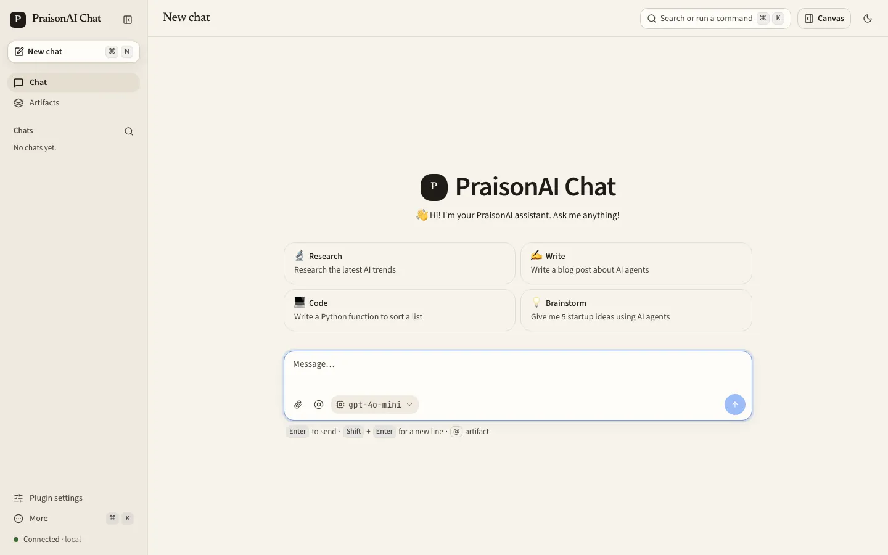
  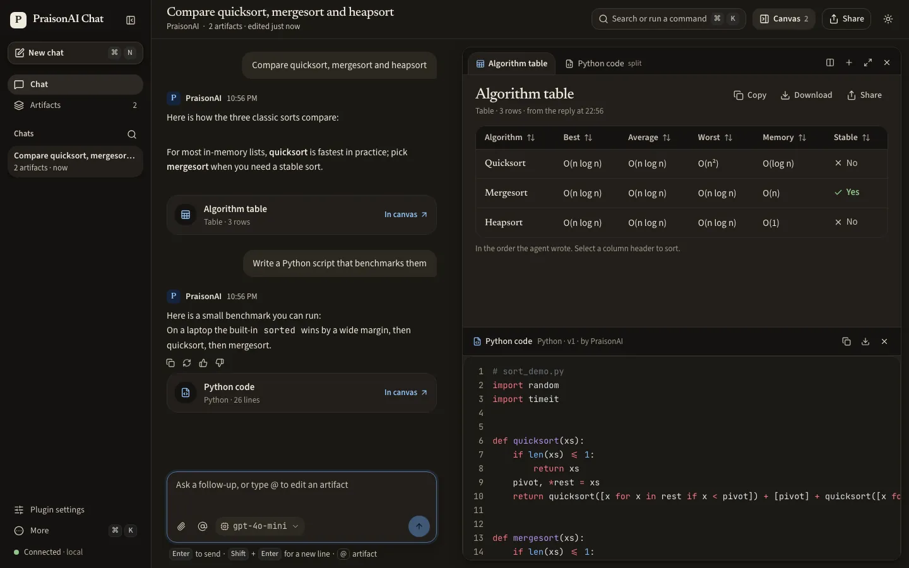
</p>

- **Welcome:** each app greets you in the new-chat hero, in every layout. Set the text with `UIPreset(welcome=...)` or your own `@aiui.welcome` handler.
- **Layout:** Chat + Canvas by default. Pick another for one run with `AIUI_LAYOUT=chat` (no canvas), `workbench`, `command`, `guided` or `mission`, or switch from the command palette (⌘K).
- **Look:** light and dark follow the toggle in the top bar; ⌘K → **Switch look: Pro** swaps the Paper look for the plain one.
- **Stop:** the Stop button cancels the agent's reply. A reply that sends nothing for 10 minutes is cancelled too (`AIUI_REPLY_IDLE_TIMEOUT`, in seconds; `0` turns it off).
- **Uploads:** request bodies are capped at 25 MiB (`AIUI_MAX_BODY_MB`; `0` turns it off).
- **Data:** chat history is saved by PraisonAI under `~/.praisonai/sessions` (set `PRAISONAI_HOME` to move it); the UI's own settings live in `~/.praisonaiui` (set `AIUI_DATA_DIR` to move them). To keep both on a mounted volume, set both variables.
- An existing `~/.praisonai/claw/app.py` from an older install keeps aiui's own default layout (Chat, no canvas) and has no welcome greeting; delete it to get the new default app, or add `layout="chat-canvas"` to its `configure_host(...)` call.

</details>

---

## Using YAML (No Code)

<details>
<summary><strong>Show YAML examples</strong></summary>

### Example 1: Two Agents Working Together

Create `agents.yaml`:

```yaml
framework: praisonai
topic: "Write a blog post about AI"

agents:
  researcher:
    role: Research Analyst
    goal: Research AI trends and gather information
    instructions: "Find accurate information about AI trends"
    
  writer:
    role: Content Writer
    goal: Write engaging blog posts
    instructions: "Write clear, engaging content based on research"
```

Run with:
```bash
praisonai agents.yaml
```

> The agents automatically work together sequentially

### Example 2: Agent with Custom Tool

Create two files in the same folder:

**agents.yaml:**
```yaml
framework: praisonai
topic: "Calculate the sum of 25 and 15"

agents:
  calculator_agent:
    role: Calculator
    goal: Perform calculations
    instructions: "Use the add_numbers tool to help with calculations"
    tools:
      - add_numbers
```

**tools.py:**
```python
def add_numbers(a: float, b: float) -> float:
    """
    Add two numbers together.
    
    Args:
        a: First number
        b: Second number
    
    Returns:
        The sum of a and b
    """
    return a + b
```

Run with:
```bash
praisonai agents.yaml
```

> 💡 **Tips:** 
> - Use the function name (e.g., `add_numbers`) in the tools list, not the file name
> - Tools in `tools.py` are automatically discovered
> - The function's docstring helps the AI understand how to use it

</details>

---

## CLI Quick Reference

| Category | Commands |
|----------|----------|
| **Execution** | `praisonai`, `--auto`, `--interactive`, `--chat` |
| **Research** | `research`, `--query-rewrite`, `--deep-research` |
| **Planning** | `--planning`, `--planning-tools`, `--planning-reasoning` |
| **Workflows** | `workflow run`, `workflow list`, `workflow auto` |
| **Memory** | `memory show`, `memory add`, `memory search`, `memory clear` |
| **Knowledge** | `knowledge add`, `knowledge query`, `knowledge list` |
| **Sessions** | `session list`, `session resume`, `session delete` |
| **Tools** | `tools list`, `tools info`, `tools search` |
| **MCP** | `mcp list`, `mcp create`, `mcp enable` |
| **Development** | `commit`, `docs`, `checkpoint`, `hooks` |
| **Scheduling** | `schedule start`, `schedule list`, `schedule stop` |

> 📖 [Full CLI reference](https://praison.ai/docs/cli/cli-reference)

---

## Key Features

<details>
<summary><strong>Show all features by category</strong></summary>

<details open>
<summary><strong>🤖 Core Agents</strong></summary>

| Feature | Code | Docs |
|---------|:----:|:----:|
| Single Agent | [Example](examples/python/agents/single-agent.py) | [📖](https://praison.ai/docs/agents/single) |
| Multi Agents | [Example](examples/python/general/mini_agents_example.py) | [📖](https://praison.ai/docs/concepts/agents) |
| Auto Agents | [Example](examples/python/general/auto_agents_example.py) | [📖](https://praison.ai/docs/features/autoagents) |
| Self Reflection AI Agents | [Example](examples/python/concepts/self-reflection-details.py) | [📖](https://praison.ai/docs/concepts/reflection) |
| Reasoning AI Agents | [Example](examples/python/concepts/reasoning-extraction.py) | [📖](https://praison.ai/docs/features/reasoning) |
| Multi Modal AI Agents | [Example](examples/python/general/multimodal.py) | [📖](https://praison.ai/docs/features/multimodal) |

</details>

<details>
<summary><strong>🔄 Workflows</strong></summary>

| Feature | Code | Docs |
|---------|:----:|:----:|
| Simple Workflow | [Example](examples/python/workflows/simple_workflow.py) | [📖](https://praison.ai/docs/concepts/agentflow) |
| Workflow with Agents | [Example](examples/python/workflows/workflow_with_agents.py) | [📖](https://praison.ai/docs/concepts/agentflow) |
| Agentic Routing (`route()`) | [Example](examples/python/workflows/workflow_routing.py) | [📖](https://praison.ai/docs/features/routing) |
| Parallel Execution (`parallel()`) | [Example](examples/python/workflows/workflow_parallel.py) | [📖](https://praison.ai/docs/features/parallelisation) |
| Loop over List/CSV (`loop()`) | [Example](examples/python/workflows/workflow_loop_csv.py) | [📖](https://praison.ai/docs/features/repetitive) |
| Evaluator-Optimizer (`repeat()`) | [Example](examples/python/workflows/workflow_repeat.py) | [📖](https://praison.ai/docs/concepts/evaluation) |
| Conditional Steps | [Example](examples/python/workflows/workflow_conditional.py) | [📖](https://praison.ai/docs/concepts/agentflow) |
| Workflow Branching | [Example](examples/python/workflows/workflow_branching.py) | [📖](https://praison.ai/docs/concepts/agentflow) |
| Workflow Early Stop | [Example](examples/python/workflows/workflow_early_stop.py) | [📖](https://praison.ai/docs/concepts/agentflow) |
| Workflow Checkpoints | [Example](examples/python/workflows/workflow_checkpoints.py) | [📖](https://praison.ai/docs/concepts/agentflow) |

</details>

<details>
<summary><strong>💻 Code & Development</strong></summary>

| Feature | Code | Docs |
|---------|:----:|:----:|
| Code Interpreter Agents | [Example](examples/python/agents/code-agent.py) | [📖](https://praison.ai/docs/features/codeagent) |
| AI Code Editing Tools | [Example](examples/python/code/code_editing_example.py) | [📖](https://praison.ai/docs/code/editing) |
| External Agents (All) | [Example](examples/python/code/external_agents_example.py) | [📖](https://praison.ai/docs/code/external-agents) |
| Claude Code CLI | [Example](examples/python/code/claude_code_example.py) | [📖](https://praison.ai/docs/code/claude-code) |
| Gemini CLI | [Example](examples/python/code/gemini_cli_example.py) | [📖](https://praison.ai/docs/code/gemini-cli) |
| Codex CLI | [Example](examples/python/code/codex_cli_example.py) | [📖](https://praison.ai/docs/code/codex-cli) |
| Cursor CLI | [Example](examples/python/code/cursor_cli_example.py) | [📖](https://praison.ai/docs/code/cursor-cli) |

</details>

<details>
<summary><strong>🧠 Memory & Knowledge</strong></summary>

| Feature | Code | Docs |
|---------|:----:|:----:|
| Memory (Short & Long Term) | [Example](examples/python/general/memory_example.py) | [📖](https://praison.ai/docs/concepts/memory) |
| File-Based Memory | [Example](examples/python/general/memory_example.py) | [📖](https://praison.ai/docs/concepts/memory) |
| Claude Memory Tool | [Example](examples/python/memory/claude_memory_example.py) | [📖](https://praison.ai/docs/features/claude-memory-tool) |
| Add Custom Knowledge | [Example](examples/python/concepts/knowledge-agents.py) | [📖](https://praison.ai/docs/concepts/knowledge) |
| RAG Agents | [Example](examples/python/concepts/rag-agents.py) | [📖](https://praison.ai/docs/concepts/rag) |
| Chat with PDF Agents | [Example](examples/python/concepts/chat-with-pdf.py) | [📖](https://praison.ai/docs/features/chat-with-pdf) |
| Data Readers (PDF, DOCX, etc.) | [CLI](https://praison.ai/docs/cli/knowledge) | [📖](https://praison.ai/docs/features/chunking-strategies) |
| Vector Store Selection | [CLI](https://praison.ai/docs/cli/knowledge) | [📖](https://praison.ai/docs/features/knowledge-backends) |
| Retrieval Strategies | [CLI](https://praison.ai/docs/cli/knowledge) | [📖](https://praison.ai/docs/features/retrieval-strategies) |
| Rerankers | [CLI](https://praison.ai/docs/cli/knowledge) | [📖](https://praison.ai/docs/features/smart-retrieval) |
| Index Types (Vector/Keyword/Hybrid) | [CLI](https://praison.ai/docs/cli/knowledge) | [📖](https://praison.ai/docs/features/incremental-indexing) |
| Query Engines (Sub-Question, etc.) | [CLI](https://praison.ai/docs/cli/knowledge) | [📖](https://praison.ai/docs/features/retrieval) |

</details>

<details>
<summary><strong>🔬 Research & Intelligence</strong></summary>

| Feature | Code | Docs |
|---------|:----:|:----:|
| Deep Research Agents | [Example](examples/python/agents/research-agent.py) | [📖](https://praison.ai/docs/agents/deep-research) |
| Query Rewriter Agent | [Example](examples/python/agents/query-rewriter-agent.py) | [📖](https://praison.ai/docs/agents/query-rewriter) |
| Native Web Search | [Example](examples/python/agents/websearch-agent.py) | [📖](https://praison.ai/docs/agents/websearch) |
| Built-in Search Tools | [Example](examples/python/agents/websearch-agent.py) | [📖](https://praison.ai/docs/tools/tavily) |
| Unified Web Search | [Example](examples/python/web_search_example.py) | [📖](https://praison.ai/docs/tools/web-search) |
| Web Fetch (Anthropic) | [Example](examples/python/agents/web-fetch-agent.py) | [📖](https://praison.ai/docs/features/model-capabilities) |

</details>

<details>
<summary><strong>📋 Planning & Execution</strong></summary>

| Feature | Code | Docs |
|---------|:----:|:----:|
| Planning Mode | [Example](examples/python/agents/planning-agent.py) | [📖](https://praison.ai/docs/concepts/planning) |
| Planning Tools | [Example](examples/python/agents/planning-agent.py) | [📖](https://praison.ai/docs/concepts/planning) |
| Planning Reasoning | [Example](examples/python/agents/planning-agent.py) | [📖](https://praison.ai/docs/concepts/planning) |
| Prompt Chaining | [Example](examples/python/general/prompt_chaining.py) | [📖](https://praison.ai/docs/features/promptchaining) |
| Evaluator Optimiser | [Example](examples/python/general/evaluator-optimiser.py) | [📖](https://praison.ai/docs/concepts/evaluation) |
| Orchestrator Workers | [Example](examples/python/general/orchestrator-workers.py) | [📖](https://praison.ai/docs/concepts/orchestration) |

</details>

<details>
<summary><strong>👥 Specialized Agents</strong></summary>

| Feature | Code | Docs |
|---------|:----:|:----:|
| Data Analyst Agent | [Example](examples/python/agents/data-analyst-agent.py) | [📖](https://praison.ai/docs/agents/data-analyst) |
| Finance Agent | [Example](examples/python/agents/finance-agent.py) | [📖](https://praison.ai/docs/agents/finance) |
| Shopping Agent | [Example](examples/python/agents/shopping-agent.py) | [📖](https://praison.ai/docs/agents/shopping) |
| Recommendation Agent | [Example](examples/python/agents/recommendation-agent.py) | [📖](https://praison.ai/docs/agents/recommendation) |
| Wikipedia Agent | [Example](examples/python/agents/wikipedia-agent.py) | [📖](https://praison.ai/docs/agents/wikipedia) |
| Programming Agent | [Example](examples/python/agents/programming-agent.py) | [📖](https://praison.ai/docs/agents/programming) |
| Math Agents | [Example](examples/python/agents/math-agent.py) | [📖](https://praison.ai/docs/features/mathagent) |
| Markdown Agent | [Example](examples/python/agents/markdown-agent.py) | [📖](https://praison.ai/docs/agents/markdown) |
| Prompt Expander Agent | [Example](examples/python/agents/prompt-expander-agent.py) | [📖](https://praison.ai/docs/agents/prompt-expander) |

</details>

<details>
<summary><strong>🎨 Media & Multimodal</strong></summary>

| Feature | Code | Docs |
|---------|:----:|:----:|
| Image Generation Agent | [Example](examples/python/image/image-agent.py) | [📖](https://praison.ai/docs/features/image-generation) |
| Image to Text Agent | [Example](examples/python/agents/image-to-text-agent.py) | [📖](https://praison.ai/docs/agents/image-to-text) |
| Video Agent | [Example](examples/python/agents/video-agent.py) | [📖](https://praison.ai/docs/agents/video) |
| Camera Integration | [Example](examples/python/camera/) | [📖](https://praison.ai/docs/features/camera-integration) |

</details>

<details>
<summary><strong>🔌 Protocols & Integration</strong></summary>

| Feature | Code | Docs |
|---------|:----:|:----:|
| MCP Transports | [Example](examples/python/mcp/mcp-transports-overview.py) | [📖](https://praison.ai/docs/mcp/transports) |
| WebSocket MCP | [Example](examples/python/mcp/websocket-mcp.py) | [📖](https://praison.ai/docs/mcp/sse-transport) |
| MCP Security | [Example](examples/python/mcp/mcp-security.py) | [📖](https://praison.ai/docs/mcp/transports) |
| MCP Resumability | [Example](examples/python/mcp/mcp-resumability.py) | [📖](https://praison.ai/docs/mcp/sse-transport) |
| MCP Config Management | [Docs](https://praison.ai/docs/cli/mcp) | [📖](https://praison.ai/docs/cli/mcp) |
| LangChain Integrated Agents | [Example](examples/python/general/langchain_example.py) | [📖](https://praison.ai/docs/features/langchain) |

</details>

<details>
<summary><strong>🛡️ Safety & Control</strong></summary>

| Feature | Code | Docs |
|---------|:----:|:----:|
| Guardrails | [Example](examples/python/guardrails/comprehensive-guardrails-example.py) | [📖](https://praison.ai/docs/concepts/guardrails) |
| Human Approval | [Example](examples/python/general/human_approval_example.py) | [📖](https://praison.ai/docs/concepts/approval) |
| Rules & Instructions | [Docs](https://praison.ai/docs/features/rules) | [📖](https://praison.ai/docs/features/rules) |

</details>

<details>
<summary><strong>⚙️ Advanced Features</strong></summary>

| Feature | Code | Docs |
|---------|:----:|:----:|
| Async & Parallel Processing | [Example](examples/python/general/async_example.py) | [📖](https://praison.ai/docs/features/async) |
| Parallelisation | [Example](examples/python/general/parallelisation.py) | [📖](https://praison.ai/docs/features/parallelisation) |
| Repetitive Agents | [Example](examples/python/concepts/repetitive-agents.py) | [📖](https://praison.ai/docs/features/repetitive) |
| Agent Handoffs | [Example](examples/python/handoff/handoff_basic.py) | [📖](https://praison.ai/docs/concepts/handoffs) |
| Stateful Agents | [Example](examples/python/stateful/workflow-state-example.py) | [📖](https://praison.ai/docs/features/stateful-agents) |
| Autonomous Workflow | [Example](examples/python/general/autonomous-agent.py) | [📖](https://praison.ai/docs/concepts/autonomy) |
| Structured Output Agents | [Example](examples/python/general/structured_agents_example.py) | [📖](https://praison.ai/docs/features/structured) |
| Model Router | [Example](examples/python/agents/router-agent-cost-optimization.py) | [📖](https://praison.ai/docs/features/model-router) |
| Prompt Caching | [Example](examples/python/agents/prompt-caching-agent.py) | [📖](https://praison.ai/docs/features/model-capabilities) |
| Fast Context | [Example](examples/context/00_agent_fast_context_basic.py) | [📖](https://praison.ai/docs/features/fast-context) |

</details>

<details>
<summary><strong>🛠️ Tools & Configuration</strong></summary>

| Feature | Code | Docs |
|---------|:----:|:----:|
| 100+ Custom Tools | [Example](examples/python/general/tools_example.py) | [📖](https://praison.ai/docs/tools/tools) |
| YAML Configuration | [Example](examples/cookbooks/yaml/secondary_market_research_agents.yaml) | [📖](https://praison.ai/docs/developers/agents-playbook) |
| 100+ LLM Support | [Example](examples/python/providers/openai/openai_gpt4_example.py) | [📖](https://praison.ai/docs/models) |
| Callback Agents | [Example](examples/python/general/advanced-callback-systems.py) | [📖](https://praison.ai/docs/concepts/hooks) |
| Hooks | [Example](examples/python/hooks/hooks_example.py) | [📖](https://praison.ai/docs/concepts/hooks) |
| Middleware System | [Example](examples/middleware/basic_middleware.py) | [📖](https://praison.ai/docs/features/middleware) |
| Configurable Model | [Example](examples/middleware/configurable_model.py) | [📖](https://praison.ai/docs/features/configurable-model) |
| Rate Limiter | [Example](examples/middleware/rate_limiter.py) | [📖](https://praison.ai/docs/features/rate-limiter) |
| Injected Tool State | [Example](examples/middleware/injected_state.py) | [📖](https://praison.ai/docs/features/injected-state) |
| Shadow Git Checkpoints | [Example](examples/checkpoints/basic_checkpoint.py) | [📖](https://praison.ai/docs/features/checkpoints) |
| Background Tasks | [Example](examples/background/basic_background.py) | [📖](https://praison.ai/docs/features/background-tasks) |
| Policy Engine | [Example](examples/policy/basic_policy.py) | [📖](https://praison.ai/docs/features/policy-engine) |
| Thinking Budgets | [Example](examples/thinking/basic_thinking.py) | [📖](https://praison.ai/docs/features/thinking-budgets) |
| Output Styles | [Example](examples/output/basic_output.py) | [📖](https://praison.ai/docs/features/output-styles) |
| Context Compaction | [Example](examples/compaction/basic_compaction.py) | [📖](https://praison.ai/docs/features/context-compaction) |

</details>

<details>
<summary><strong>📊 Monitoring & Management</strong></summary>

| Feature | Code | Docs |
|---------|:----:|:----:|
| Sessions Management | [Example](examples/python/sessions/comprehensive-session-management.py) | [📖](https://praison.ai/docs/concepts/session-management) |
| Auto-Save Sessions | [Docs](https://praison.ai/docs/cli/session) | [📖](https://praison.ai/docs/cli/session) |
| History in Context | [Docs](https://praison.ai/docs/cli/session) | [📖](https://praison.ai/docs/cli/session) |
| Telemetry | [Example](examples/python/telemetry/production-telemetry-example.py) | [📖](https://praison.ai/docs/features/telemetry) |
| Langfuse Tracing | [Docs](https://praison.ai/docs/observability/langfuse) | [📖](https://praison.ai/docs/observability/langfuse) |
| Project Docs (.praison/docs/) | [Docs](https://praison.ai/docs/cli/docs) | [📖](https://praison.ai/docs/cli/docs) |
| AI Commit Messages | [Docs](https://praison.ai/docs/cli/commit) | [📖](https://praison.ai/docs/cli/commit) |
| @Mentions in Prompts | [Docs](https://praison.ai/docs/cli/mentions) | [📖](https://praison.ai/docs/cli/mentions) |

</details>

<details>
<summary><strong>🖥️ CLI Features</strong></summary>

| Feature | Code | Docs |
|---------|:----:|:----:|
| Slash Commands | [Example](examples/python/cli/slash_commands_example.py) | [📖](https://praison.ai/docs/cli/slash-commands) |
| Autonomy Modes | [Example](examples/python/cli/autonomy_modes_example.py) | [📖](https://praison.ai/docs/cli/autonomy-modes) |
| Cost Tracking | [Example](examples/python/cli/cost_tracking_example.py) | [📖](https://praison.ai/docs/cli/cost-tracking) |
| Repository Map | [Example](examples/python/cli/repo_map_example.py) | [📖](https://praison.ai/docs/cli/repo-map) |
| Interactive TUI | [Example](examples/python/cli/interactive_tui_example.py) | [📖](https://praison.ai/docs/cli/interactive-tui) |
| Git Integration | [Example](examples/python/cli/git_integration_example.py) | [📖](https://praison.ai/docs/cli/git-integration) |
| Sandbox Execution | [Example](examples/python/cli/sandbox_execution_example.py) | [📖](https://praison.ai/docs/cli/sandbox-execution) |
| CLI Compare | [Example](examples/compare/cli_compare_basic.py) | [📖](https://praison.ai/docs/cli/compare) |
| Profile/Benchmark | [Docs](https://praison.ai/docs/cli/profile) | [📖](https://praison.ai/docs/cli/profile) |
| Auto Mode | [Docs](https://praison.ai/docs/cli/auto) | [📖](https://praison.ai/docs/cli/auto) |
| Init | [Docs](https://praison.ai/docs/cli/init) | [📖](https://praison.ai/docs/cli/init) |
| File Input | [Docs](https://praison.ai/docs/cli/file-input) | [📖](https://praison.ai/docs/cli/file-input) |
| Final Agent | [Docs](https://praison.ai/docs/cli/final-agent) | [📖](https://praison.ai/docs/cli/final-agent) |
| Max Tokens | [Docs](https://praison.ai/docs/cli/max-tokens) | [📖](https://praison.ai/docs/cli/max-tokens) |

</details>

<details>
<summary><strong>🧪 Evaluation</strong></summary>

| Feature | Code | Docs |
|---------|:----:|:----:|
| Accuracy Evaluation | [Example](examples/eval/accuracy_example.py) | [📖](https://praison.ai/docs/cli/eval) |
| Performance Evaluation | [Example](examples/eval/performance_example.py) | [📖](https://praison.ai/docs/cli/eval) |
| Reliability Evaluation | [Example](examples/eval/reliability_example.py) | [📖](https://praison.ai/docs/cli/eval) |
| Criteria Evaluation | [Example](examples/eval/criteria_example.py) | [📖](https://praison.ai/docs/cli/eval) |

</details>

<details>
<summary><strong>🎯 Agent Skills</strong></summary>

| Feature | Code | Docs |
|---------|:----:|:----:|
| Skills Management | [Example](examples/skills/basic_skill_usage.py) | [📖](https://praison.ai/docs/concepts/skills) |
| Custom Skills | [Example](examples/skills/custom_skill_example.py) | [📖](https://praison.ai/docs/concepts/skills) |

</details>

<details>
<summary><strong>⏰ 24/7 Scheduling</strong></summary>

| Feature | Code | Docs |
|---------|:----:|:----:|
| Agent Scheduler | [Example](examples/python/scheduled_agents/news_checker_live.py) | [📖](https://praison.ai/docs/cli/scheduler) |

</details>

</details>

---

## Performance

PraisonAI keeps framework overhead microsecond-class: creating an `Agent` (one tool, no LLM call) averaged **46 μs** in our 2026-10-15 run, so per-agent setup is negligible next to model latency in multi-agent workloads.

| Performance Metric | PraisonAI | Measured |
|--------------------|-----------|----------|
| Avg Agent instantiation (1 tool, 1000 iterations) | **46 μs** | 2026-10-15 · praisonaiagents 1.7.12 |

Methodology, comparisons and how to reproduce: [benchmarks/BENCHMARK_RESULTS.md](https://github.com/MervinPraison/PraisonAI/blob/main/src/praisonai-agents/benchmarks/BENCHMARK_RESULTS.md) · [docs](https://praison.ai/docs/developers/benchmarks)

---

---

## Langfuse Tracing

```bash
pip install "praisonai[langfuse]"
praisonai langfuse
```

<p align="center">
  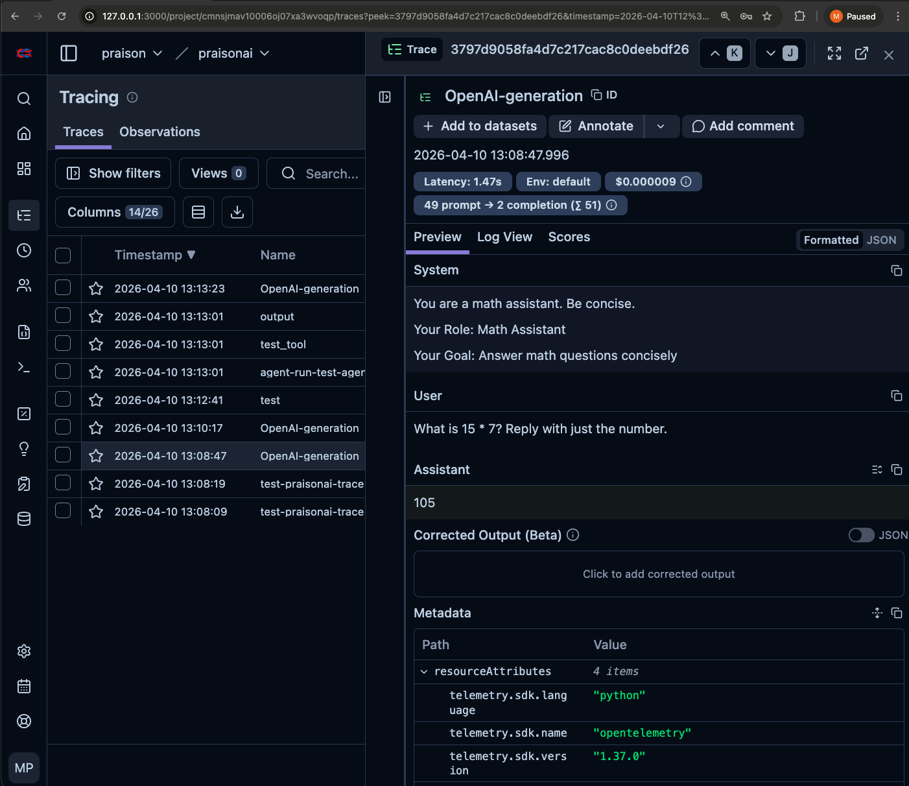
</p>

---

## Video Tutorials

Learn PraisonAI through our comprehensive video series:

<details>
<summary><strong>View all 22 video tutorials</strong></summary>

| Topic | Video |
|-------|--------|
| AI Agents with Self Reflection | [](https://www.youtube.com/watch?v=vLXobEN2Vc8) |
| Reasoning Data Generating Agent | [](https://www.youtube.com/watch?v=fUT332Y2zA8) |
| AI Agents with Reasoning | [](https://www.youtube.com/watch?v=KNDVWGN3TpM) |
| Multimodal AI Agents | [](https://www.youtube.com/watch?v=hjAWmUT1qqY) |
| AI Agents Workflow | [](https://www.youtube.com/watch?v=yWTH44QPl2A) |
| Async AI Agents | [](https://www.youtube.com/watch?v=VhVQfgo00LE) |
| Mini AI Agents | [](https://www.youtube.com/watch?v=OkvYp5aAGSg) |
| AI Agents with Memory | [](https://www.youtube.com/watch?v=1hVfVxvPnnQ) |
| Repetitive Agents | [](https://www.youtube.com/watch?v=dAYGxsjDOPg) |
| Introduction | [](https://www.youtube.com/watch?v=Fn1lQjC0GO0) |
| Tools Overview | [](https://www.youtube.com/watch?v=XaQRgRpV7jo) |
| Custom Tools | [](https://www.youtube.com/watch?v=JSU2Rndh06c) |
| Firecrawl Integration | [](https://www.youtube.com/watch?v=UoqUDcLcOYo) |
| User Interface | [](https://www.youtube.com/watch?v=tg-ZjNl3OCg) |
| Crawl4AI Integration | [](https://www.youtube.com/watch?v=KAvuVUh0XU8) |
| Chat Interface | [](https://www.youtube.com/watch?v=sw3uDqn2h1Y) |
| Code Interface | [](https://www.youtube.com/watch?v=_5jQayO-MQY) |
| Mem0 Integration | [](https://www.youtube.com/watch?v=KIGSgRxf1cY) |
| Training | [](https://www.youtube.com/watch?v=aLawE8kwCrI) |
| Realtime Voice Interface | [](https://www.youtube.com/watch?v=frRHfevTCSw) |
| Call Interface | [](https://www.youtube.com/watch?v=m1cwrUG2iAk) |
| Reasoning Extract Agents | [](https://www.youtube.com/watch?v=2PPamsADjJA) |

</details>

---

## Contributing

We welcome contributions! Fork the repo, create a branch, and submit a PR → [Contributing Guide](https://github.com/MervinPraison/PraisonAI/blob/main/CONTRIBUTING.md).

---

## FAQ & Troubleshooting

<details>
<summary><strong>Show FAQ and troubleshooting</strong></summary>

<details>
<summary><strong>ModuleNotFoundError: No module named 'praisonai'</strong></summary>

Install the package:
```bash
pip install praisonai
```

Using only the core library? `pip install praisonaiagents` and import from `praisonaiagents` instead.

</details>

<details>
<summary><strong>API key not found / Authentication error</strong></summary>

Ensure your API key is set:
```bash
export OPENAI_API_KEY=your_key_here
```

For other providers, see [Models docs](https://praison.ai/docs/models).

</details>

<details>
<summary><strong>How do I use a local model (Ollama)?</strong></summary>

```bash
# Start Ollama and pull a model
ollama serve
ollama pull llama3.2
```

```python
from praisonai import Agent

agent = Agent(instructions="You are a helpful assistant", llm="ollama/llama3.2")
agent.start("Why is the sky blue?")
```

The `ollama/` prefix is what selects Ollama's handling — tool-call repair,
tool-result formatting and the streaming rules small local models need. Or set
it by environment instead:

```bash
export OPENAI_MODEL_NAME=ollama/llama3.2
```

Setting only `OPENAI_BASE_URL` is not enough: with no model named, the OpenAI
default (`gpt-4o-mini`) is sent to Ollama, which answers
`404 model 'gpt-4o-mini' not found`. Always name the model.

Point at a non-default host with `base_url=` or `OLLAMA_HOST`:

```python
agent = Agent(instructions="...", llm="ollama/llama3.2", base_url="http://192.168.1.10:11434")
```

The same shape works for other local runtimes — `lm_studio/`, `vllm/` and
`hosted_vllm/` with their server's `base_url`.

See [Models docs](https://praison.ai/docs/models) for more details.

</details>

<details>
<summary><strong>How do I persist conversations to a database?</strong></summary>

Use the `db` parameter:
```python
from praisonai import Agent, db

agent = Agent(
    name="Assistant",
    memory={
        "db": db(database_url="postgresql://localhost/mydb"),
        "session_id": "my-session",
    },
)
```

See [Persistence docs](https://praison.ai/docs/databases/overview) for supported databases.

</details>

<details>
<summary><strong>How do I enable agent memory?</strong></summary>

```python
from praisonai import Agent

agent = Agent(
    name="Assistant",
    # Enables file-based memory (no extra deps!)
    memory={"user_id": "user123"},
)
```

See [Memory docs](https://praison.ai/docs/concepts/memory) for more options.

</details>

<details>
<summary><strong>How do I run multiple agents together?</strong></summary>

```python
from praisonai import Agent, Agents

agent1 = Agent(instructions="Research topics")
agent2 = Agent(instructions="Summarize findings")
agents = Agents(agents=[agent1, agent2])
agents.start()
```

See [Agents docs](https://praison.ai/docs/concepts/agents) for more examples.

</details>

<details>
<summary><strong>How do I use MCP tools?</strong></summary>

```python
from praisonai import Agent, MCP

agent = Agent(
    tools=MCP("npx @modelcontextprotocol/server-memory")
)
```

See [MCP docs](https://praison.ai/docs/mcp/transports) for all transport options.

</details>

</details>

### Getting Help

- 📚 [Full Documentation](https://praison.ai/docs)
- 🐛 [Report Issues](https://github.com/MervinPraison/PraisonAI/issues)
- 💬 [Discussions](https://github.com/MervinPraison/PraisonAI/discussions)

---

<div align="center">
  <p><strong>Made with ❤️ by the PraisonAI Team</strong></p>
  <p>
    <a href="https://praison.ai/docs">📚 Documentation</a> •
    <a href="https://github.com/MervinPraison/PraisonAI">GitHub</a> •
    <a href="https://youtube.com/@MervinPraison">▶️ YouTube</a> •
    <a href="https://x.com/MervinPraison">𝕏 X</a> •
    <a href="https://linkedin.com/in/mervinpraison">💼 LinkedIn</a>
  </p>
</div>

---

## What's new

| What's new | What it is |
|:--|:--|
| **Six products, one framework** | Bot, Code, MCP and Train now install on their own: `pip install praisonai-bot`, `praisonai-code`, `praisonai-mcp`, `praisonai-train`. `pip install praisonai` still installs everything. |
| **[`praisonai connect`](https://praison.ai/docs/cli/mcp)** | One command puts your agents and 85 tools in 22 MCP clients: Cursor, VS Code, Claude Desktop, Claude Code, Codex, Zed and more. |
| **[Replay](https://praison.ai/docs/features/replay)** | Record any agent run, then replay it step by step, rerun from a node, or export it to HTML, Mermaid or OpenTelemetry. |
| **[Dashboard](https://praison.ai/docs/concepts/claw)** | Chat + Canvas, a microphone in the composer, and a Connect page for MCP clients. `pip install "praisonai[dashboard]"` |
| **[v4.8.0](https://github.com/MervinPraison/PraisonAI/releases/tag/v4.8.0)** | A security hardening release. 608 releases in the last 12 months. |

## Star History

[](https://star-history.com/#MervinPraison/PraisonAI&Date)
