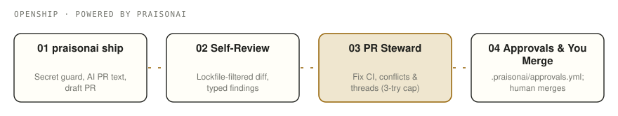

# OpenShip — Open-Source Claude Ship, Powered by PraisonAI

[](https://github.com/MervinPraison/PraisonAI)
[](../../LICENSE)
[](https://www.python.org/downloads/)

> **Enjoying OpenShip?** Star **[MervinPraison/PraisonAI](https://github.com/MervinPraison/PraisonAI)** — OpenShip ships inside PraisonAI with zero duplicated runtime code.

**OpenShip turns a feature branch into a reviewed, CI-green draft PR — on any LLM or local Ollama — and never merges.**

<p align="center">
  <picture>
    <source media="(prefers-color-scheme: dark)" srcset="images/architecture-dark.svg" />
    
  </picture>
</p>

## OpenShip vs Claude Ship

| Capability | OpenShip (PraisonAI) | Claude Ship |
|---|---|---|
| **Pillar 1 — Self-Review** | **Inline PR diff comments**, repo `REVIEW.md` guidelines, adversarial verification pass (`high`+), typed severities (`important` / `nit` / `pre_existing`), effort caps (`low`..`max`) | Built-in inline review + `REVIEW.md` |
| **Pillar 2 — PR Steward** | Fixes failing CI (`workflow_run`), merge conflicts, review threads & `@praisonai` directives; **stateless-safe 3-attempt circuit breaker**; `@praisonai stop` / `openship-stop` label; `git revert <sha>` comment | Built-in PR steward |
| **Pillar 3 — Declarative Approvals** | `.praisonai/approvals.yml` (`observe` / `enforce` modes, `protected_paths`, path-scoped rules, loaded strictly from `origin/<base>`) | Declarative approvals |
| **Runs Directly in GitHub** | **Free drop-in 3-job GitHub Actions workflow** (`workflows/openship.yml` — zero external server, zero vendor fee) | Hosted Claude GitHub App (Team/Enterprise paid) |
| **LLM Support** | **Any LLM** (OpenAI, Anthropic, Gemini, OpenRouter, vLLM, LM Studio, **100% local Ollama**) | Anthropic Claude only |
| **Visual Web UI** | **Built-in PraisonAIUI plugin** (`aiui openship serve` — Overview, Self-Review, PR Steward, PR Policy) | claude.ai web settings |
| **License** | **MIT Open Source** (inspect, self-host, extend — ships directly inside `praisonai-code`) | Proprietary |
| **Human-in-the-Loop** | **Draft PR by default; never merges, approves, or force-pushes** | Human merge |

## Install

OpenShip ships directly inside **`praisonai-code`** (included with `pip install praisonai`):

```bash
pip install praisonai-code
# With the built-in PraisonAIUI visual web dashboard:
pip install "praisonai-code[ui]"
```

> **Run directly in GitHub Actions (zero server):** Copy [`workflows/openship.yml`](workflows/openship.yml) into `.github/workflows/openship.yml` and add your preferred LLM API key (`OPENAI_API_KEY`, `ANTHROPIC_API_KEY`, or `GEMINI_API_KEY`) as a repository secret. Every PR automatically gets inline self-review, CI-fixing PR Steward (`@praisonai stop` to halt), and `.praisonai/approvals.yml` policy checks.

## Quick Start (4 Ways)

### 1. Standalone CLI

```bash
# Preview the exact plan without changing anything
praisonai ship --dry-run

# Run a fast self-review (important findings only) and open a draft PR
praisonai ship low

# Open a draft PR, post the self-review, and watch CI/threads in one flow
praisonai ship --post-review --watch

# Run a single PR steward cycle against the current branch's PR
praisonai steward --once

# Evaluate the current PR against declarative approval rules
praisonai approvals --policy examples/approvals.yml
praisonai approvals --enforce --json
```

### 2. Interactive CLI (`praisonai code` and `praisonai chat`)

Inside any interactive `praisonai code` or `praisonai chat` session, run the exact same commands as slash commands:

```text
/ship --dry-run
/steward
/approvals --json
```

Interactive `/steward` automatically runs a single cycle (`--once`) so your session never blocks on a continuous watch loop.

### 3. 100% Local Offline Ollama

No cloud API key required — run the entire ship + review + PR text flow on your own machine:

```bash
ollama pull qwen3.5
praisonai ship --model ollama/qwen3.5
```

See [`examples/ship_ollama.sh`](examples/ship_ollama.sh) for a ready-to-run shell script.

### 4. Python API, Free GitHub Actions CI Steward & Declarative Approvals

- **Python API** — see [`examples/ship_python.py`](examples/ship_python.py):

  ```python
  from praisonai_code.ship import ship

  res = ship(dry_run=True)
  print(res.dry_run_plan)
  ```

- **Free GitHub Actions CI Steward** — copy [`workflows/steward.yml`](workflows/steward.yml) into `.github/workflows/steward.yml` to run `praisonai steward <PR> --once` automatically on CI failures and review comments.
- **Declarative Approvals** — copy [`examples/approvals.yml`](examples/approvals.yml) to `.praisonai/approvals.yml` on your default branch to declare `protected_paths` and path-scoped reviewer rules.

### 5. Visual Web UI (Built Into `praisonai-code` via PraisonAIUI)

`praisonai-code` ships a native **`praisonaiui.plugins`** entry point (`openship = "praisonai_code.ship.ui_plugin:plugin"`) built purely on PraisonAIUI's default block SDK (zero custom JS build, automatic light/dark mode and mobile layout):

```bash
pip install "praisonai-code[ui]"
aiui openship serve          # launch focused OpenShip UI at http://127.0.0.1:8765
```

Pages included: **Overview** (PR queue, 4-stage pipeline stepper, severity chart, activity timeline), **Self-Review** (diff viewer + live AI review on any LLM/Ollama), **PR Steward** (checks, threads, 3-attempt circuit breaker, revert helper), and **PR Policy** (`.praisonai/approvals.yml` verdicts + observe audit). All GitHub write actions require explicit confirmation, and merge/approve/force-push remain permanently absent.

## Safety Guarantees

OpenShip is built to keep a human firmly in control of every merge:

- **Hard `before_tool` guard:** Blocks `gh pr merge` (including `--auto`), `gh pr review --approve`, `gh api` merge/approve calls, and `git push --force*` at the tool boundary — OpenShip **never merges, never approves, and never force-pushes**.
- **Draft-by-default:** Every pull request is opened as a draft on your feature branch; running `praisonai ship` on `main` (or a fork) is refused before any commit or push.
- **Secret-file refusal:** Refuses to commit `.env` files, private keys, or other secret paths detected by PraisonAI's shared secret-path guard.
- **3-attempt circuit breaker:** PR Steward caps retries per failing check, conflict, or review thread so an unfixable issue never loops indefinitely.
- **Default-branch policy loading:** `.praisonai/approvals.yml` is read from the repository's default branch so a pull request cannot weaken its own approval rules.
- **Global kill switch:** Set `PRAISONAI_DISABLE_SHIP=1` (or `[ship] enabled = false` in config) to disable `ship` and `steward` completely.

## Files in This Package

| Path | Purpose |
|---|---|
| [`workflows/steward.yml`](workflows/steward.yml) | Copy-paste GitHub Actions workflow for free CI PR stewardship |
| [`examples/approvals.yml`](examples/approvals.yml) | Starter `.praisonai/approvals.yml` declarative approval policy |
| [`examples/ship_python.py`](examples/ship_python.py) | Python API example (`ship`, `review_diff`, `watch_pr`, `evaluate_policy`) |
| [`examples/ship_ollama.sh`](examples/ship_ollama.sh) | 100% local offline Ollama workflow |
| [`pyproject.toml`](pyproject.toml) | Thin `praisonai-ship` meta-package (zero duplicated Python code) |
